# diorama

Your desktop as a themeable 3D world in a full-screen browser. Every window lives
on an object in the scene; focusing one flies the camera in and swaps the 3D
screen for a pixel-exact, fully interactive 2D view. Some worlds you can walk
around in: a starship, a house, an office tower, where wall calendars, clocks,
calculators and filing cabinets are the app launchers.

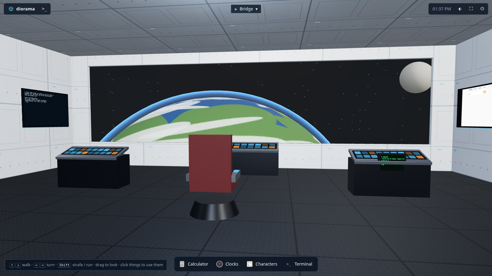

<table>
<tr>
<td>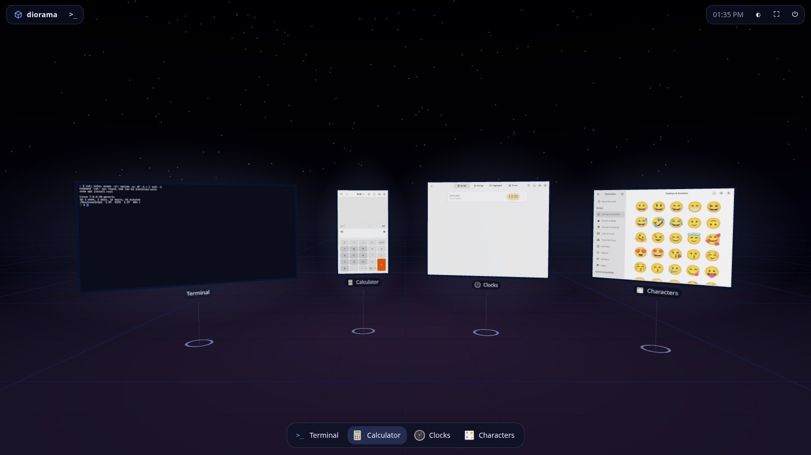</td>
<td>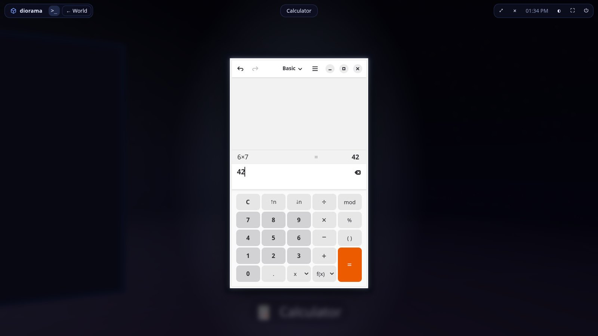</td>
</tr>
<tr>
<td align="center"><b>Orbit</b>: real Linux apps on glass panels</td>
<td align="center">Click one: the camera flies in and it becomes a live 1:1 window</td>
</tr>
<tr>
<td>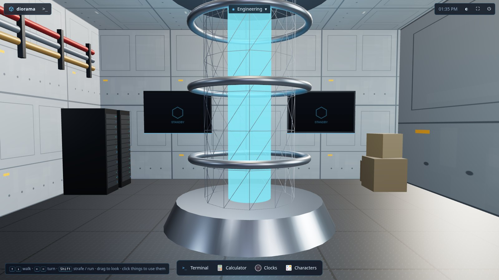</td>
<td>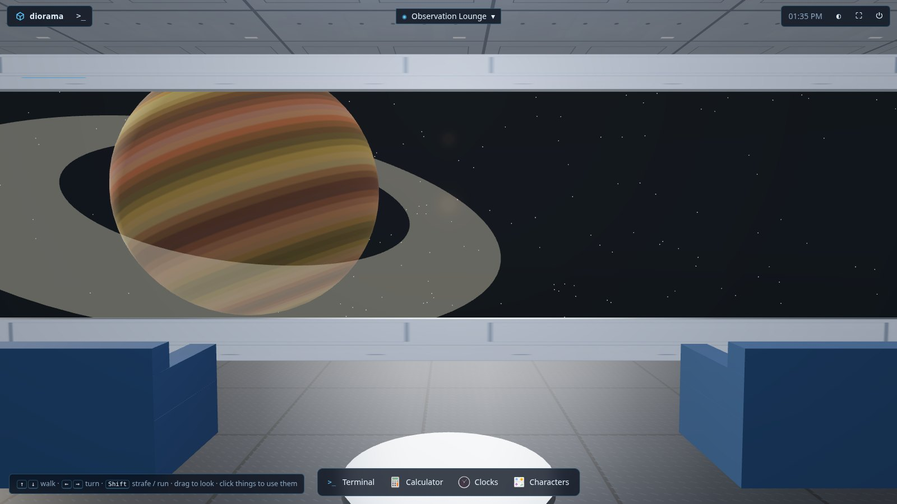</td>
</tr>
<tr>
<td align="center"><b>Starship</b>: engineering</td>
<td align="center">Observation lounge</td>
</tr>
<tr>
<td>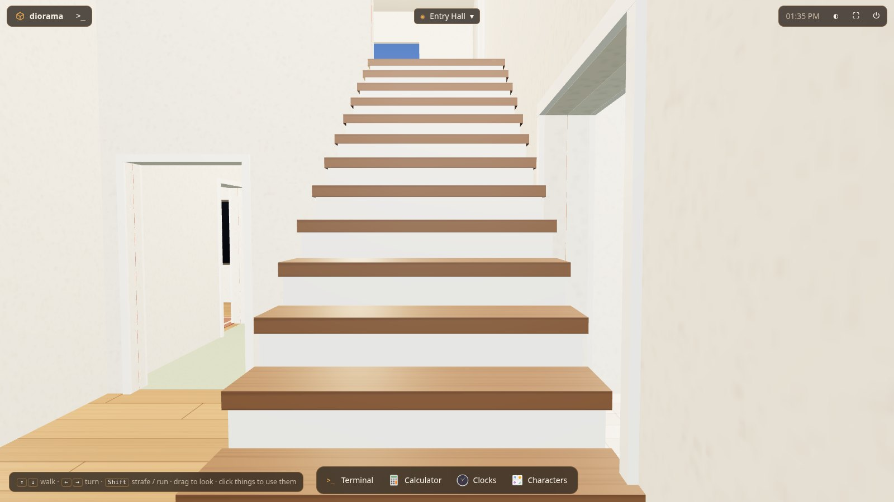</td>
<td>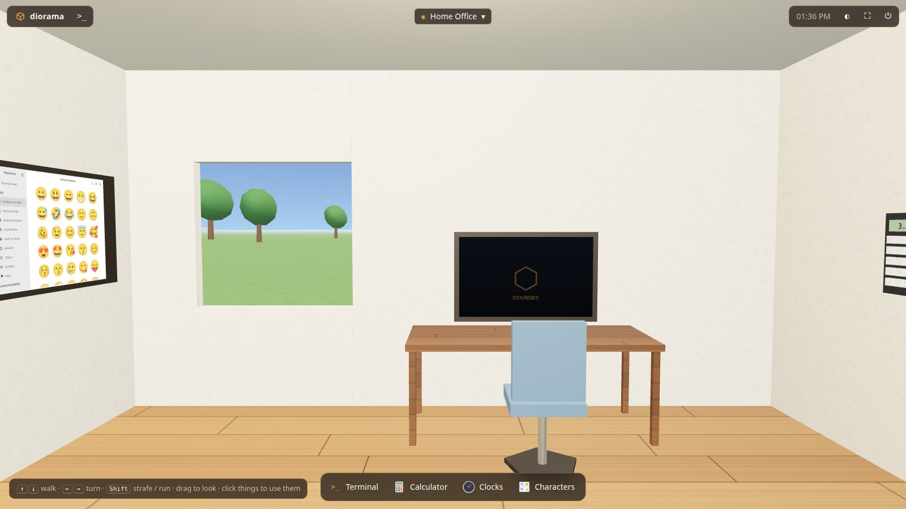</td>
</tr>
<tr>
<td align="center"><b>House</b>: walk upstairs</td>
<td align="center">Home office: the calculator on the wall opens Calculator</td>
</tr>
<tr>
<td>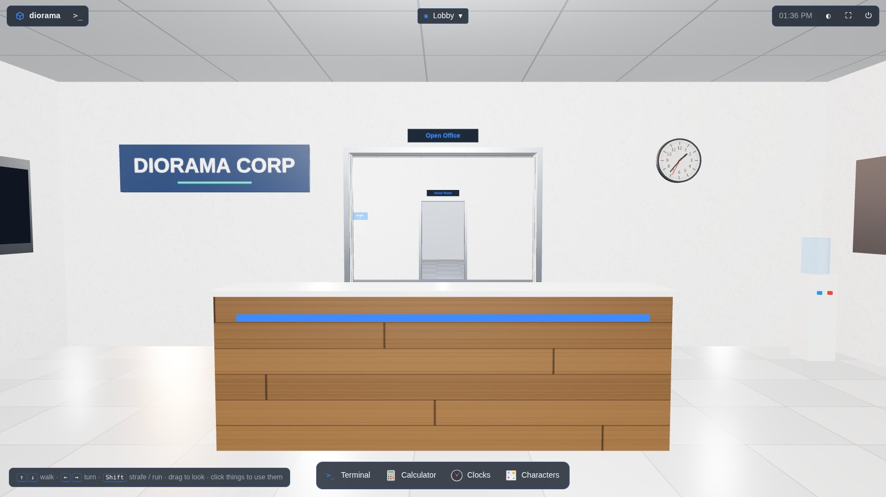</td>
<td>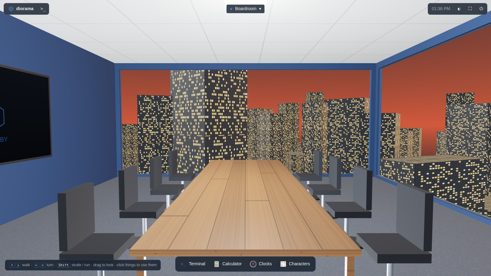</td>
</tr>
<tr>
<td align="center"><b>Corporate HQ</b>: lobby</td>
<td align="center">Boardroom above the city</td>
</tr>
<tr>
<td>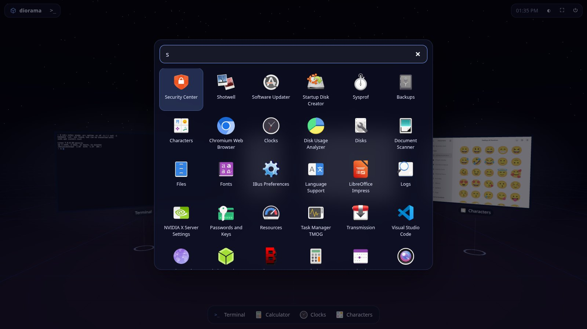</td>
<td>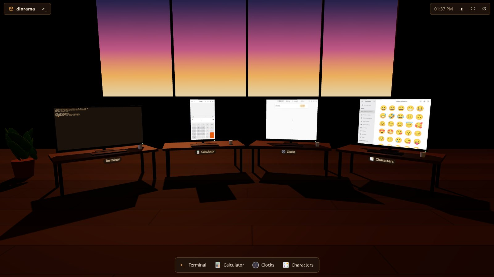</td>
</tr>
<tr>
<td align="center">Start typing anywhere to launch an app</td>
<td align="center"><b>Workshop</b></td>
</tr>
</table>

<details>
<summary>More screenshots</summary>

| | |
|---|---|
| 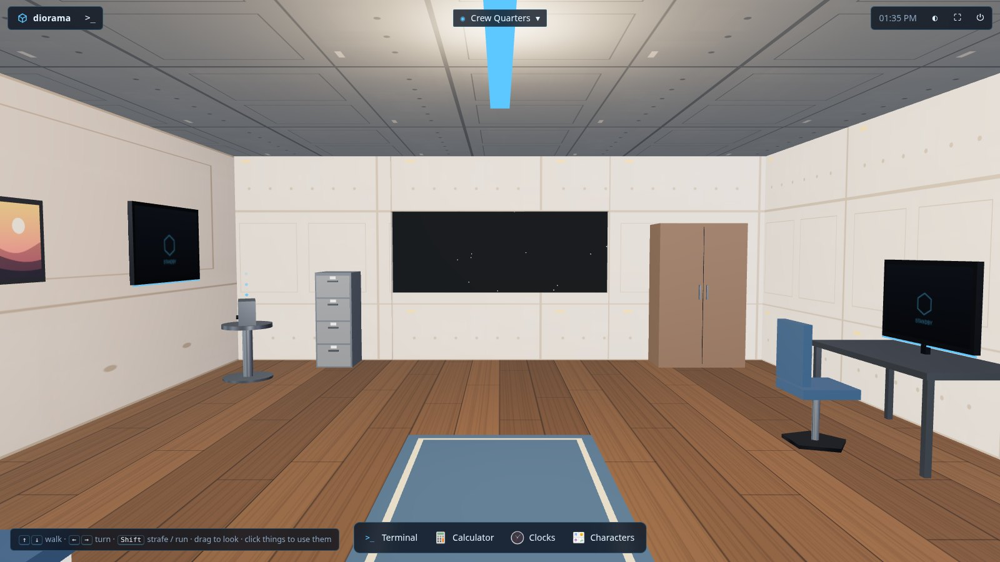 | 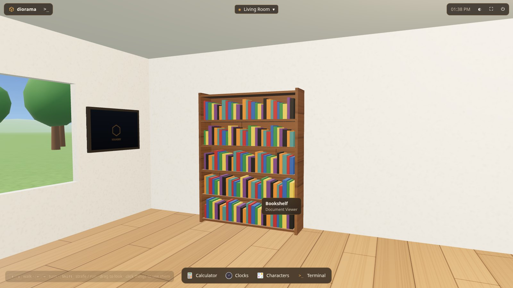 |
| Starship crew quarters | Hover an object to see what it opens |
| 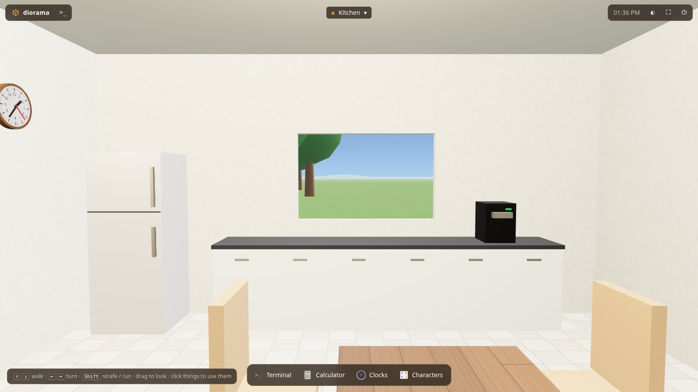 | 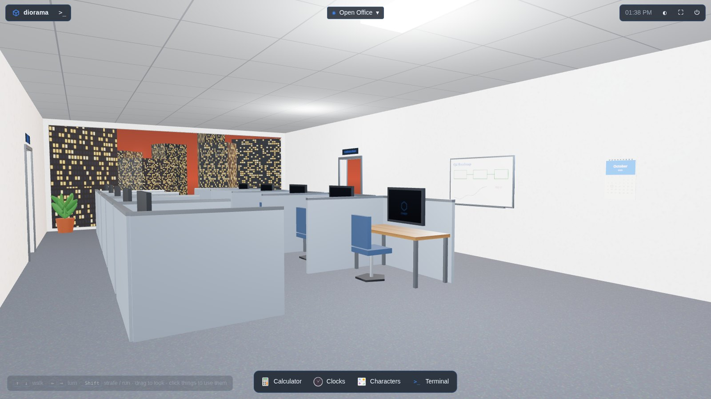 |
| House kitchen | Open office: every cubicle monitor can host a window |
| 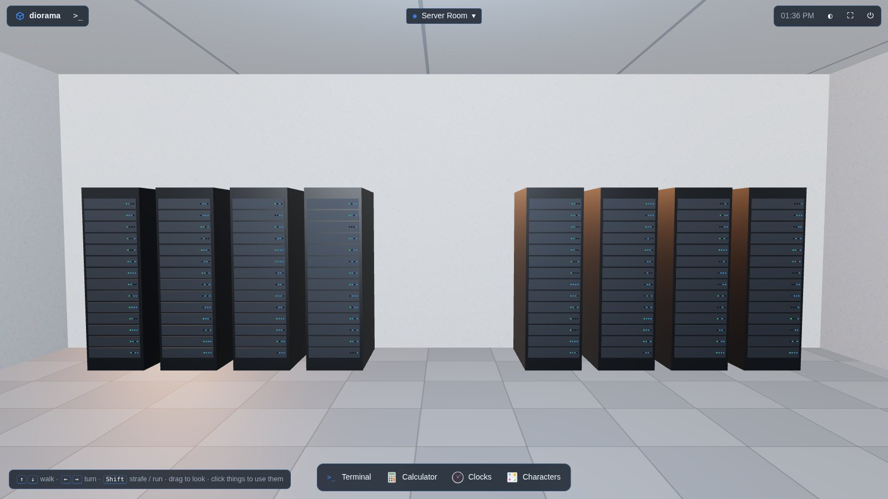 | |
| Server room: racks open the system monitor, VMs, logs | |

</details>

## Quick start

```
npm install && npm run build
node dist/server/cli.js            # or: npm link && diorama
```

First start asks for a password (or generates one when not on a TTY), then serves
`https://<every-interface>:7443/`. The certificate is self-signed; accept it once.
Click ⛶ for full screen. That also turns on Keyboard Lock, so chords like
Ctrl+W reach your apps instead of the browser.

| Key / action | Does |
|---|---|
| click a window in the world, or its taskbar entry | focus it |
| `Ctrl+Alt+Space` | back to the world (or open the launcher when already there) |
| start typing in the world | app search; Enter launches |
| click the dimmed backdrop | back to the world |
| ⤢ / ✕ in the top bar | resize the native window to fill the view / close it |
| ◐ in the top bar | switch worlds (remembered per browser) |
| `↑` `↓` / `←` `→` | walk / turn in walkable worlds (`Shift`: run / strafe), drag to look, wheel to step |
| click an object in a room | open its app (calendar, calculator, notepad...), or focus it if already open |
| ◉ room name in the top bar | where you are; click to travel to another room |

## How it works

```
browser (three.js world + 2D focus overlay)
   │  wss: JSON control + binary JPEG tiles
server (node)
   ├── LinuxProvider ── private Xvfb (cookie-auth) + private D-Bus
   │     we are the window manager: windows are laid out non-overlapping
   │     on a big virtual screen, captured per-window via Composite+Damage,
   │     input injected with XTest in root coordinates
   ├── Terminals ────── node-pty, survive browser reloads (backlog replay)
   ├── Notifications ── org.freedesktop.Notifications on the private bus
   └── AppCatalog ───── .desktop files + icon themes
```

* Only damaged regions are re-encoded. The focused window streams at 30 fps, the rest at 4 fps.
* App, menu, and dialog windows are separate surfaces. Menus and dialogs draw over their parent in the focus view.
* Keys are sent as physical key codes (`KeyboardEvent.code` → evdev), so XKB in the session handles layouts. X does its own autorepeat.
* The X bell, terminal bells, and desktop notifications sound in the browser. App audio stays on the server.
* `WindowProvider` (`server/providers/types.ts`) is the seam for a Windows backend.

## Themes

| Theme | Kind | What it is |
|---|---|---|
| `orbit` (default) | showcase | glass panels on an arc under a night sky |
| `workshop` | showcase | monitors on desks in a room at dusk |
| `starship` | walkable | bridge, engineering (reactor), science lab, medical bay, crew quarters, observation lounge; windows onto Orbit's space |
| `house` | walkable | two storeys with stairs: living room, kitchen, office, library, bedroom, hobby studio, bathroom |
| `tower` | walkable | corporate HQ above a city at dusk: lobby, open office with cubicles, conference, server room, records, mail, break room; atrium stairs up to the executive suite, boardroom and sky lounge |

Switch with the ◐ menu, `?theme=house`, `--theme`, or `"theme"` in
`~/.config/diorama/config.json`.

In walkable worlds, windows hang on wall screens and desk monitors. A new window
goes to a free screen in the room you are in, or to the screen next to the
object that launched it; with every screen taken, a free-standing one appears in
front of you. Objects on walls and furniture are app launchers: they resolve by
desktop id then freedesktop category, so they work across distros, and say
"not installed" otherwise.

A theme is an ES module whose default export is `(ctx) => Theme`. See
`client/src/theme.ts` for the full contract. Put user themes in
`~/.config/diorama/themes/<name>/index.js`; their assets are served next to them
(`ctx.asset('model.glb')`). Use `ctx.THREE` rather than importing three.

```js
export default function myTheme({ THREE, scene }) {
  return {
    name: 'mine',
    css: { '--accent': '#00ffa3' },
    setup() { scene.background = new THREE.Color('#001b12'); },
    createHost(win) {
      const screen = new THREE.Mesh(new THREE.PlaneGeometry(1, 1), new THREE.MeshBasicMaterial({ map: win.texture }));
      return {
        object: screen, screen,
        update(w) {
          screen.material.map = w.texture;
          screen.material.needsUpdate = true;
          screen.scale.set(w.width / 600, w.height / 600, 1);
        },
      };
    },
    layout(list) { list.forEach(({ host }, i) => host.object.position.set((i - list.length / 2) * 3, 1.6, 0)); },
  };
}
```

A theme controls the world, which object hosts each window, layout, per-frame
animation and entities, the chrome's CSS variables, terminal colours, and the
focus camera pose, duration, and easing. Themes may supply a `navigator` (the
built-in walker) and register clickable objects with `ctx.addProp(obj, { label, app, slot })`.

The walkable themes are built with the kit in `client/src/themes/kit/`:

```ts
const kit = createKit(ctx, 'scifi');               // or 'home' | 'office'
kit.b.room({ id: 'lab', name: 'Lab', x0: 0, z0: 0, x1: 8, z1: 6 });
kit.b.room({ id: 'hall', name: 'Hall', x0: 8, z0: 0, x1: 11, z1: 6, hidden: true });
kit.b.door('lab', 'hall', 3, { sign: true });       // cut through both walls
kit.b.window('lab', 'n', 4, 3);                     // glass, blocks walking
kit.b.build();
kit.b.screen('lab-1', 'lab', 'w', 3, 1.8, 1.6, 1.0); // a wall display windows can land on
kit.wallApp(kit.P.calendar(), 'lab', 'n', 1.5, 1.6, 'Calendar', APPS.calendar, 'lab-1');
kit.b.stairs({ x0, z0, x1, z1, y0: 0, y1: 3.1, axis: 'z', up: -1 }); // walkable
// theme: { setup, createHost: kit.createHost, frame: kit.frame, navigator: kit.walker }
```

`window.diorama.world` is exposed in the browser console for poking at a theme.

## Config (`~/.config/diorama/config.json`)

`host`, `port`, `tls`, `certFile`/`keyFile`, `theme`, `display`,
`screen` (virtual X screen size), `capture.{focusedFps,backgroundFps,jpegQuality}`,
`sessionHours`. Change the password with `diorama passwd`.
`DIORAMA_DEBUG=1` logs X errors and D-Bus output.

## Security

Anyone who logs in gets a shell as the user running diorama. The login is a
scrypt-hashed password, an HMAC-signed `HttpOnly; Secure; SameSite=Strict`
cookie, per-IP backoff on failures, and a same-origin check on the WebSocket.
Xvfb listens on a unix socket only and requires a magic cookie. Bind to a
specific interface or put it behind a VPN if 0.0.0.0 is broader than you want.

## Not done yet

* Clipboard sync between the browser and X selections
* Windows provider (Windows.Graphics.Capture + SendInput via a napi-rs addon)
* HiDPI: X pixels map 1:1 to CSS pixels
* Dragging a window edge to resize (use ⤢ or the app's maximize button)
* Terminals don't survive a server restart; X apps die with the server
